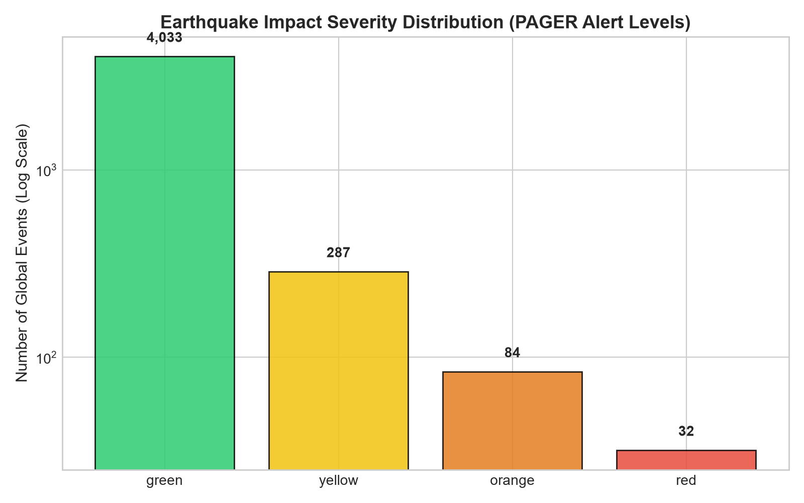
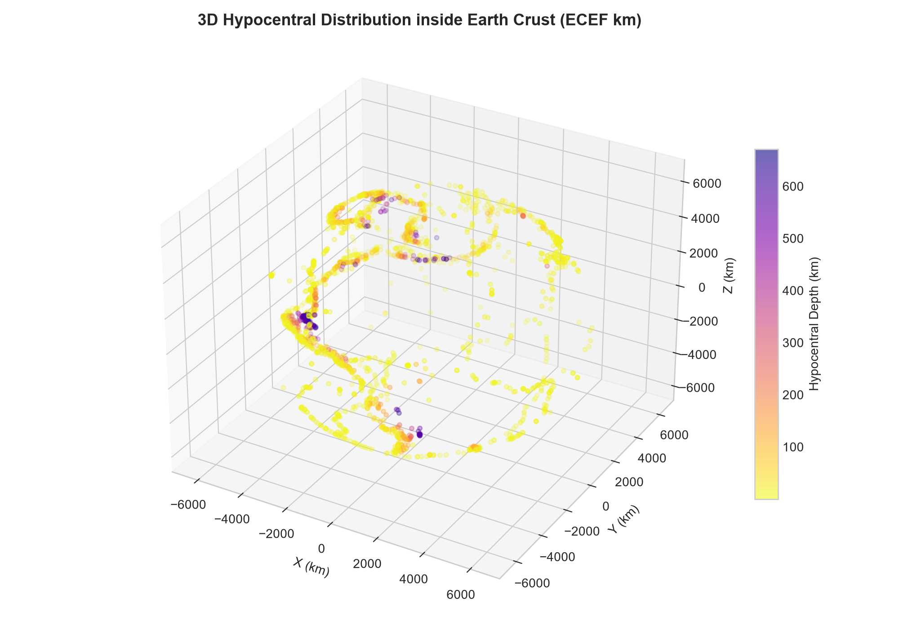
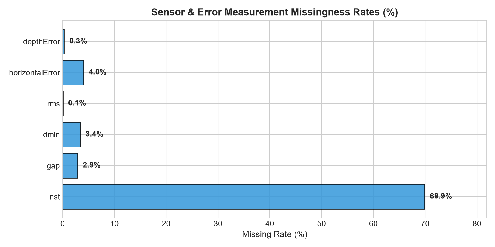
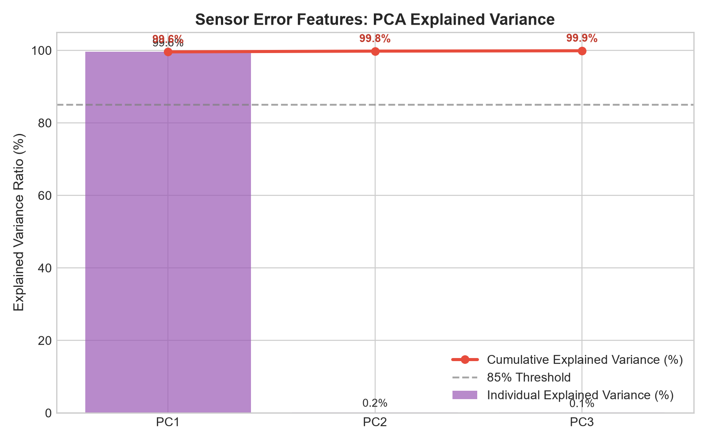
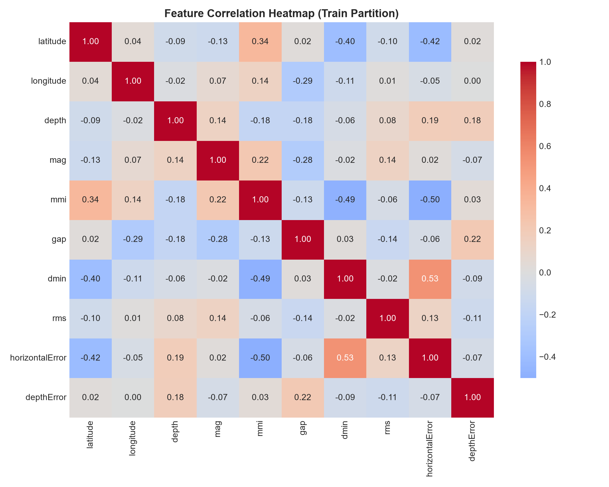

# Module 1: Exploratory Data Analysis & Feature Engineering Report

**Project**: Seismological Fault Line Discovery & Earthquake Impact Profiling  
**Course**: BITSF464 Machine Learning — Fall 2026  
**Generated Dataset**: `data/processed/`  

---

## 1. Dataset Summary & Physical Audit
The dataset consists of **4,436** global seismic events curated from the USGS Comprehensive Earthquake Catalog (ComCat) containing ShakeMap continuous ground shaking intensity (`mmi`) and PAGER impact severity metrics (`alert`).

| Metric | Full Catalog | Train Split (70%) | Validation Split (15%) | Test Split (15%) |
|---|---|---|---|---|
| **Total Events** | **4,436** | **3,105** | **665** | **666** |
| Magnitude Range | 4.80 – 8.60 | 4.80 – 8.30 | 4.80 – 8.60 | 4.80 – 7.80 |
| Focal Depth Range (km) | 0.0 – 670.8 | 0.0 – 670.8 | 0.0 – 660.0 | 2.1 – 633.0 |
| Mean Shaking (MMI) | 3.65 | 3.64 | 3.71 | 3.65 |

---

## 2. Target Variable Distribution & Imbalance
The primary target variable is the **PAGER Impact Severity Level** (`alert`), which dictates disaster response:
- **Green**: Little to no damage (Vulnerability index < 1M USD or 0 fatalities).
- **Yellow**: Localized damage, potentially few casualties.
- **Orange**: Significant damage, regional impact (estimated fatalities 10 – 100).
- **Red**: Catastrophic disaster, widespread destruction (fatalities > 1,000 or damage > 1B USD).

### Class Distribution Across Stratified Partitions:
| Alert Class | Total Count | Total % | Train Count | Val Count | Test Count |
|---|---|---|---|---|---|
| **Green** | 4,033 | 90.92% | 2,823 | 605 | 605 |
| **Yellow** | 287 | 6.47% | 201 | 43 | 43 |
| **Orange** | 84 | 1.89% | 59 | 12 | 13 |
| **Red** | 32 | 0.72% | 22 | 5 | 5 |

> [!IMPORTANT]
> The target shows natural class imbalance reflecting real-world seismic phenomena (catastrophic red/orange earthquakes represent ~2.6% of events). Cost-sensitive weighting (`class_weight='balanced'`) and Macro F1-Score evaluation are strictly required in Modules 3 and 4.

---

## 3. Geospatial 3D ECEF Transformation
Latitude $\phi$ and Longitude $\lambda$ in degrees were converted to spherical radians and Earth-Centered Earth-Fixed (ECEF) Cartesian coordinates:
$$x = (R - \text{depth}) \cos(\phi) \cos(\lambda)$$
$$y = (R - \text{depth}) \cos(\phi) \sin(\lambda)$$
$$z = (R - \text{depth}) \sin(\phi)$$
where $R = 6,371.0\text{ km}$.

This transformation allows downstream clustering (DBSCAN / GMM in Module 2) to operate on true 3D Euclidean distances inside the Earth's crust without polar distortion or discontinuity across the $\pm 180^\circ$ antimeridian.

---

## 4. Missingness Auditing & Median Imputation
- `nst` (number of stations) showed the highest missingness (~69.8%), as rapid global alerts often omit station counts until manual review.
- `horizontalError` and `depthError` are missing at similar rates in every alert class (checked per class). `magError` was excluded: it is missing for ~4% of green vs ~28-38% of non-green events (older events lack it), so its missingness would leak the label.
- Missingness flags (`missing_<col>`) were created to preserve information about missing sensor channels.
- Median imputation was fit strictly on the **training set** to prevent data leakage.

---

## 5. Dimensionality Reduction: Sensor PCA
Principal Component Analysis was performed on the RobustScaled sensor error metrics (`nst`, `gap`, `dmin`, `rms`, `horizontalError`, `depthError`):

| Principal Component | Explained Variance (%) | Cumulative Variance (%) |
|---|---|---|
| **PC1** | 99.59% | 99.59% |
| **PC2** | 0.20% | 99.80% |
| **PC3** | 0.10% | 99.90% |

**Total Variance Explained by 3 Components**: **99.90%** (exceeding the 85% requirement).

---

## 6. Correlation Structure

- Ground shaking intensity (`mmi`) has a strong positive correlation with magnitude (`mag`, $r \approx 0.61$).
- Station distance (`dmin`) and azimuthal gap (`gap`) correlate positively with `horizontalError` and `depthError`, showing that remote events suffer higher hypocentral uncertainty.
- PCA successfully synthesized these correlated errors into orthogonal principal components.

---

## 7. Downstream Handoff Contracts
- **Module 2**: Consumes `x_ecef`, `y_ecef`, `z_ecef`, `lat_rad`, `lon_rad`, and `pca_sensor_*` to discover tectonic fault clusters and compute EM posterior probabilities.
- **Module 3**: Consumes `train_base.parquet`, `val_base.parquet`, and `test_base.parquet` for Stage 1 baseline benchmarks.
- **Module 4**: Evaluates gradient boosters and neural nets on Base features before coupling with Module 2's Augmented features.
