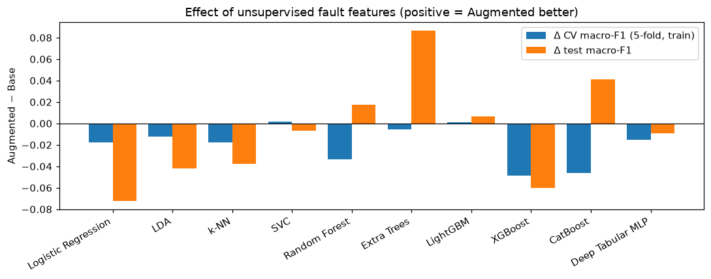
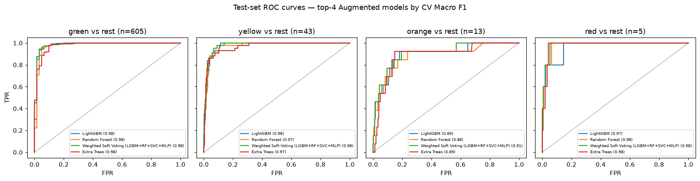
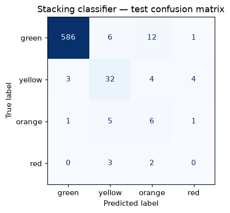

# Module 4 — Final Comparative Leaderboard

Test set: 666 events (green 605, yellow 43, orange 13, red 5).
CV Macro F1 = 5-fold stratified CV on train (mean ± std); all other metrics on the held-out test set.
Feature sets follow Module 3's rule: Base = 39 columns, Augmented = 64 (Base + 25 Module 2 columns).
Module 3 rows: *Module 3 delivered* = Module 3's own tuned Augmented models, scored from their delivered OOF/test probabilities on the shared folds; *re-run in M4* = the same families re-tuned under Module 4's protocol on both feature sets (used for the Base-vs-Augmented tests).
Stacking Level-0 source for Module 3 models: Module 3 delivered (module3/artifacts/oof_predictions).
> Note (lr): pickled with scikit-learn 1.9.0 (running 1.9.1)
> Note (lda): pickled with scikit-learn 1.6.1 (running 1.9.1)
> Note (knn): saved model not loadable outside Module 3's notebook (AttributeError: Can't get attribute 'CustomKNN' on <module '__main__'>)

| Model Family | Specific Model | Feature Set | CV Macro F1 | Macro F1 | Weighted F1 | Multi-Class ROC-AUC | Log Loss | Latency (ms) |
|---|---|---|---|---|---|---|---|---|
| Linear (M3) | Logistic Regression (L1, C=0.1) — Module 3 delivered | **Augmented** | 0.4555 ± 0.0540 | 0.4500 | 0.9154 | 0.9396 | 0.2790 | 1.90 |
| Linear (M3) | Logistic Regression (L2, C=10.0) — re-run in M4 | Base | 0.4663 ± 0.0543 | 0.5321 | 0.9256 | 0.9539 | 0.2542 | 1.57 |
| Linear (M3) | Logistic Regression (L2, C=10.0) — re-run in M4 | **Augmented** | 0.4483 ± 0.0619 | 0.4598 | 0.9171 | 0.9410 | 0.2884 | 1.60 |
| Probabilistic (M3) | LDA (eigen, shrinkage=auto) — Module 3 delivered | **Augmented** | 0.4589 ± 0.0304 | 0.4724 | 0.9421 | 0.9492 | 0.6300 | 2.15 |
| Probabilistic (M3) | LDA (lsqr, shrinkage=auto) — re-run in M4 | Base | 0.4709 ± 0.0423 | 0.5146 | 0.9459 | 0.9494 | 0.5924 | 1.62 |
| Probabilistic (M3) | LDA (lsqr, shrinkage=auto) — re-run in M4 | **Augmented** | 0.4589 ± 0.0304 | 0.4724 | 0.9421 | 0.9492 | 0.6300 | 1.69 |
| Instance (M3) | k-NN (Module 3) — Module 3 delivered | **Augmented** | 0.4758 ± 0.0462 | 0.4461 | 0.9415 | 0.8190 | 1.0880 | nan |
| Instance (M3) | k-NN (k=3, distance) — re-run in M4 | Base | 0.4925 ± 0.0519 | 0.4824 | 0.9453 | 0.8496 | 0.9837 | 2.53 |
| Instance (M3) | k-NN (k=3, uniform) — re-run in M4 | **Augmented** | 0.4748 ± 0.0283 | 0.4449 | 0.9396 | 0.8191 | 1.0861 | 2.78 |
| Kernel (M3) | SVC (poly deg=3, C=1.0) — Module 3 delivered | **Augmented** | 0.4430 ± 0.0269 | 0.4693 | 0.9475 | 0.9601 | 0.1623 | 1.53 |
| Kernel (M3) | SVC (poly deg=2, C=1.0) — re-run in M4 | Base | 0.4370 ± 0.0198 | 0.4670 | 0.9463 | 0.9449 | 0.1574 | 3.99 |
| Kernel (M3) | SVC (poly deg=2, C=10.0) — re-run in M4 | **Augmented** | 0.4385 ± 0.0243 | 0.4600 | 0.9445 | 0.9409 | 0.1699 | 2.28 |
| Tree Ensemble (M4) | Random Forest | Base | 0.5725 ± 0.0528 | 0.5359 | 0.9442 | 0.9569 | 0.1727 | 32.11 |
| Tree Ensemble (M4) | Random Forest | **Augmented** | 0.5392 ± 0.0653 | 0.5531 | 0.9447 | 0.9535 | 0.1831 | 30.81 |
| Tree Ensemble (M4) | Extra Trees | Base | 0.5320 ± 0.0384 | 0.4440 | 0.9304 | 0.9476 | 0.2525 | 32.20 |
| Tree Ensemble (M4) | Extra Trees | **Augmented** | 0.5263 ± 0.0589 | 0.5304 | 0.9422 | 0.9531 | 0.1681 | 33.47 |
| Gradient Boost (M4) | LightGBM | Base | 0.5402 ± 0.0748 | 0.5692 | 0.9502 | 0.9530 | 0.1668 | 1.58 |
| Gradient Boost (M4) | LightGBM | **Augmented** | 0.5414 ± 0.0426 | 0.5760 | 0.9461 | 0.9548 | 0.1659 | 1.41 |
| Gradient Boost (M4) | XGBoost | Base | 0.5303 ± 0.0708 | 0.5797 | 0.9414 | 0.9528 | 0.2260 | 3.45 |
| Gradient Boost (M4) | XGBoost | **Augmented** | 0.4815 ± 0.0638 | 0.5197 | 0.9368 | 0.9541 | 0.2241 | 4.36 |
| Gradient Boost (M4) | CatBoost | Base | 0.5564 ± 0.0848 | 0.5606 | 0.9447 | 0.9598 | 0.1679 | 2.34 |
| Gradient Boost (M4) | CatBoost | **Augmented** | 0.5104 ± 0.0520 | 0.6020 | 0.9456 | 0.9566 | 0.1606 | 2.79 |
| Neural Network (M4) | Deep Tabular MLP | Base | 0.4184 ± 0.0465 | 0.4671 | 0.9075 | 0.9256 | 0.4480 | 1.26 |
| Neural Network (M4) | Deep Tabular MLP | **Augmented** | 0.4028 ± 0.0686 | 0.4576 | 0.9198 | 0.9435 | 0.4858 | 0.87 |
| Ensemble (M4) | Weighted Soft Voting (LGBM+RF+SVC+MLP) | **Augmented** | 0.5320 ± 0.0505 | 0.5911 | 0.9532 | 0.9631 | 0.2047 | 41.46 |
| Ensemble (M4) | Stacking Classifier (Shallow LightGBM meta) | **Augmented** | 0.5220 ± 0.0402 | 0.5060 | 0.9437 | 0.9478 | 0.1954 | 56.82 |

## Top 5 by CV Macro F1
| Specific Model | Feature Set | CV Macro F1 | Macro F1 | Multi-Class ROC-AUC |
|---|---|---|---|---|
| Random Forest | Base | 0.5725 | 0.5359 | 0.9569 |
| CatBoost | Base | 0.5564 | 0.5606 | 0.9598 |
| LightGBM | Augmented | 0.5414 | 0.5760 | 0.9548 |
| LightGBM | Base | 0.5402 | 0.5692 | 0.9530 |
| Random Forest | Augmented | 0.5392 | 0.5531 | 0.9535 |

## Base → Augmented deltas (single models)
| model | Δ cv_macro_f1 | Δ test_macro_f1 | Δ test_roc_auc | Δ test_log_loss |
|---|---|---|---|---|
| Logistic Regression | -0.0180 | -0.0724 | -0.0129 | 0.0342 |
| LDA | -0.0120 | -0.0422 | -0.0002 | 0.0376 |
| k-NN | -0.0176 | -0.0375 | -0.0305 | 0.1024 |
| SVC | 0.0015 | -0.0070 | -0.0040 | 0.0125 |
| Random Forest | -0.0332 | 0.0172 | -0.0034 | 0.0105 |
| Extra Trees | -0.0056 | 0.0865 | 0.0055 | -0.0844 |
| LightGBM | 0.0012 | 0.0068 | 0.0018 | -0.0010 |
| XGBoost | -0.0489 | -0.0601 | 0.0013 | -0.0019 |
| CatBoost | -0.0460 | 0.0414 | -0.0032 | -0.0072 |
| Deep Tabular MLP | -0.0156 | -0.0094 | 0.0179 | 0.0378 |

## Figures

