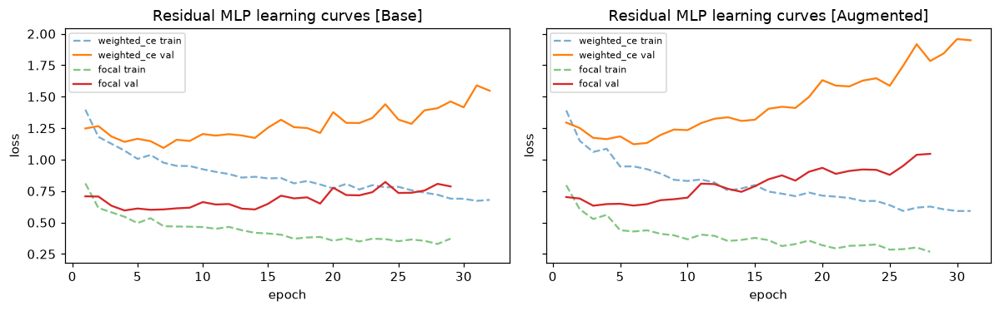

# Module 4 — Final Comparative Leaderboard

Test set: 666 events (green 605, yellow 43, orange 13, red 5).
CV Macro F1 = 5-fold stratified CV on train (mean ± std); all other metrics on the held-out test set.
Feature sets follow Module 3's rule: Base = 36 columns, Augmented = 61 (Base + 25 Module 2 columns).
Module 3 rows: *Module 3 delivered* = Module 3's own tuned Augmented models, scored from their delivered OOF/test probabilities on the shared folds; *re-run in M4* = the same families re-tuned under Module 4's protocol on both feature sets (used for the Base-vs-Augmented tests).
Stacking Level-0 source for Module 3 models: Module 3 delivered (module3/artifacts/oof_predictions).
> Note (lr): pickled with scikit-learn 1.6.1 (running 1.9.1)
> Note (lda): pickled with scikit-learn 1.6.1 (running 1.9.1)
> Note (knn): saved model not loadable outside Module 3's notebook (AttributeError: Can't get attribute 'CustomKNN' on <module '__main__'>)
> Note (svm): pickled with scikit-learn 1.6.1 (running 1.9.1)

| Model Family | Specific Model | Feature Set | CV Macro F1 | Macro F1 | Weighted F1 | Multi-Class ROC-AUC | Log Loss | Latency (ms) |
|---|---|---|---|---|---|---|---|---|
| Linear (M3) | Logistic Regression (L2, C=10.0) — Module 3 delivered | **Augmented** | 0.3407 ± 0.0441 | 0.3207 | 0.8202 | 0.8605 | 0.6014 | 0.67 |
| Linear (M3) | Logistic Regression (L2, C=10.0) — re-run in M4 | Base | 0.3456 ± 0.0338 | 0.3451 | 0.8267 | 0.8545 | 0.6659 | 0.89 |
| Linear (M3) | Logistic Regression (L2, C=0.1) — re-run in M4 | **Augmented** | 0.3308 ± 0.0167 | 0.3437 | 0.8332 | 0.8580 | 0.5851 | 1.21 |
| Probabilistic (M3) | LDA (eigen, shrinkage=0.5) — Module 3 delivered | **Augmented** | 0.3664 ± 0.0263 | 0.3548 | 0.9002 | 0.8775 | 0.3643 | 0.66 |
| Probabilistic (M3) | LDA (lsqr, shrinkage=auto) — re-run in M4 | Base | 0.3238 ± 0.0602 | 0.3060 | 0.8931 | 0.8522 | 0.3219 | 0.96 |
| Probabilistic (M3) | LDA (lsqr, shrinkage=auto) — re-run in M4 | **Augmented** | 0.3585 ± 0.0282 | 0.3158 | 0.8966 | 0.8676 | 0.3675 | 1.13 |
| Instance (M3) | k-NN (Module 3) — Module 3 delivered | **Augmented** | 0.3633 ± 0.0215 | 0.3821 | 0.9011 | 0.7888 | 1.9439 | nan |
| Instance (M3) | k-NN (k=3, distance) — re-run in M4 | Base | 0.3324 ± 0.0241 | 0.3627 | 0.9006 | 0.8028 | 1.6917 | 17.33 |
| Instance (M3) | k-NN (k=3, distance) — re-run in M4 | **Augmented** | 0.3633 ± 0.0215 | 0.3821 | 0.9011 | 0.7903 | 1.9439 | 18.83 |
| Kernel (M3) | SVC (rbf, C=10.0) — Module 3 delivered | **Augmented** | 0.2964 ± 0.0203 | 0.2950 | 0.8843 | 0.9076 | 0.2669 | 1.06 |
| Kernel (M3) | SVC (RBF, C=10.0) — re-run in M4 | Base | 0.2904 ± 0.0113 | 0.2650 | 0.8740 | 0.9035 | 0.2698 | 0.86 |
| Kernel (M3) | SVC (RBF, C=10.0) — re-run in M4 | **Augmented** | 0.2964 ± 0.0203 | 0.2950 | 0.8843 | 0.9076 | 0.2669 | 0.81 |
| Tree Ensemble (M4) | Random Forest | Base | 0.3872 ± 0.0316 | 0.4351 | 0.9014 | 0.9059 | 0.3028 | 18.85 |
| Tree Ensemble (M4) | Random Forest | **Augmented** | 0.4236 ± 0.0329 | 0.4389 | 0.8983 | 0.9038 | 0.3422 | 19.96 |
| Tree Ensemble (M4) | Extra Trees | Base | 0.4174 ± 0.0566 | 0.3868 | 0.8921 | 0.9027 | 0.4061 | 20.07 |
| Tree Ensemble (M4) | Extra Trees | **Augmented** | 0.3998 ± 0.0377 | 0.3846 | 0.8898 | 0.8997 | 0.4436 | 20.30 |
| Gradient Boost (M4) | LightGBM | Base | 0.4542 ± 0.0596 | 0.4349 | 0.8964 | 0.9071 | 0.2836 | 0.84 |
| Gradient Boost (M4) | LightGBM | **Augmented** | 0.4018 ± 0.0359 | 0.4713 | 0.9044 | 0.9188 | 0.2611 | 0.89 |
| Gradient Boost (M4) | XGBoost | Base | 0.4014 ± 0.0405 | 0.4307 | 0.8681 | 0.9088 | 0.4616 | 2.08 |
| Gradient Boost (M4) | XGBoost | **Augmented** | 0.4079 ± 0.0543 | 0.4468 | 0.8944 | 0.9168 | 0.3028 | 2.74 |
| Gradient Boost (M4) | CatBoost | Base | 0.4454 ± 0.0723 | 0.4350 | 0.8883 | 0.9077 | 0.3406 | 0.87 |
| Gradient Boost (M4) | CatBoost | **Augmented** | 0.3934 ± 0.0325 | 0.4422 | 0.8879 | 0.9078 | 0.3332 | 1.47 |
| Neural Network (M4) | Deep Tabular MLP | Base | 0.2876 ± 0.0377 | 0.3150 | 0.7997 | 0.8404 | 0.8345 | 0.52 |
| Neural Network (M4) | Deep Tabular MLP | **Augmented** | 0.2880 ± 0.0504 | 0.3308 | 0.8113 | 0.8569 | 0.7571 | 0.40 |
| Ensemble (M4) | Weighted Soft Voting (LGBM+RF+SVC+MLP) | **Augmented** | 0.4010 ± 0.0277 | 0.5095 | 0.9127 | 0.9170 | 0.3267 | 24.20 |
| Ensemble (M4) | Stacking Classifier (Shallow LightGBM meta) | **Augmented** | 0.4295 ± 0.0380 | 0.4403 | 0.8620 | 0.8936 | 0.4279 | 70.44 |

## Top 5 by CV Macro F1
| Specific Model | Feature Set | CV Macro F1 | Macro F1 | Multi-Class ROC-AUC |
|---|---|---|---|---|
| LightGBM | Base | 0.4542 | 0.4349 | 0.9071 |
| CatBoost | Base | 0.4454 | 0.4350 | 0.9077 |
| Stacking Classifier (Shallow LightGBM meta) | Augmented | 0.4295 | 0.4403 | 0.8936 |
| Random Forest | Augmented | 0.4236 | 0.4389 | 0.9038 |
| Extra Trees | Base | 0.4174 | 0.3868 | 0.9027 |

## Base → Augmented deltas (single models)
| model | Δ cv_macro_f1 | Δ test_macro_f1 | Δ test_roc_auc | Δ test_log_loss |
|---|---|---|---|---|
| Logistic Regression | -0.0148 | -0.0014 | 0.0036 | -0.0807 |
| LDA | 0.0346 | 0.0098 | 0.0154 | 0.0456 |
| k-NN | 0.0308 | 0.0195 | -0.0125 | 0.2522 |
| SVC | 0.0060 | 0.0300 | 0.0040 | -0.0028 |
| Random Forest | 0.0364 | 0.0038 | -0.0021 | 0.0395 |
| Extra Trees | -0.0177 | -0.0021 | -0.0030 | 0.0375 |
| LightGBM | -0.0524 | 0.0363 | 0.0118 | -0.0225 |
| XGBoost | 0.0066 | 0.0160 | 0.0080 | -0.1587 |
| CatBoost | -0.0520 | 0.0072 | 0.0001 | -0.0074 |
| Deep Tabular MLP | 0.0004 | 0.0158 | 0.0165 | -0.0773 |

## Figures

