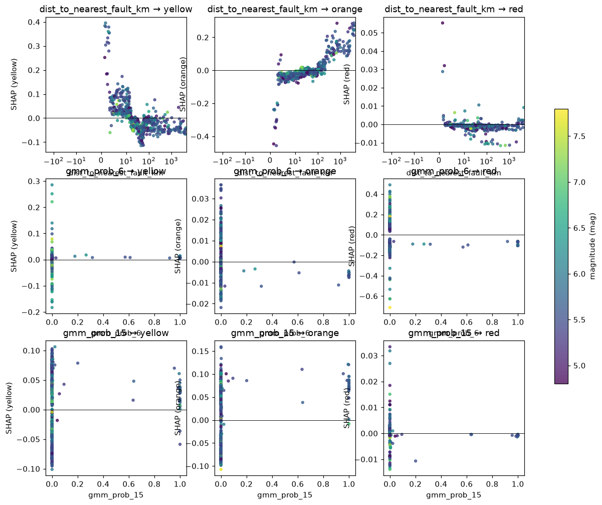
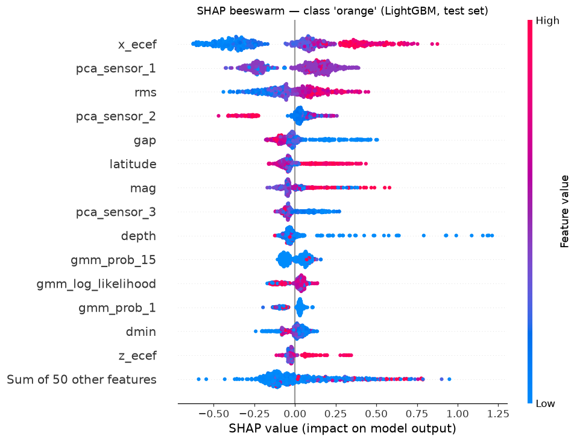

# Module 4 — SHAP Explainability Report

Model explained: **LightGBM (Augmented)** — the best gradient booster by 5-fold CV Macro F1
(0.5414). Explainer: `shap.TreeExplainer` (exact TreeSHAP), 666 test events,
values in log-odds space per class.

## Global importance
Top-5 features: `missing_depthError`, `mag`, `x_ecef`, `horizontalError`, `missing_magError`.

| feature | rank | yellow | orange | red | total |
|---|---|---|---|---|---|
| missing_depthError | 1 | 0.1603 | 0.0000 | 0.0076 | 0.7479 |
| mag | 2 | 0.1663 | 0.0699 | 0.0741 | 0.7184 |
| x_ecef | 3 | 0.0221 | 0.3063 | 0.0793 | 0.4932 |
| horizontalError | 4 | 0.2852 | 0.0095 | 0.0000 | 0.3395 |
| missing_magError | 5 | 0.0056 | 0.0000 | 0.1249 | 0.2955 |
| pca_sensor_1 | 6 | 0.0405 | 0.1830 | 0.0142 | 0.2428 |
| gap | 7 | 0.0725 | 0.0830 | 0.0569 | 0.2153 |
| dmin | 8 | 0.0624 | 0.0448 | 0.0110 | 0.1814 |
| rms | 9 | 0.0217 | 0.1259 | 0.0117 | 0.1743 |
| pca_sensor_2 | 10 | 0.0767 | 0.0852 | 0.0013 | 0.1704 |
| gmm_prob_6 | 11 | 0.0140 | 0.0072 | 0.1260 | 0.1576 |
| gmm_prob_15 | 12 | 0.0537 | 0.0610 | 0.0022 | 0.1412 |
| pca_sensor_3 | 13 | 0.0495 | 0.0688 | 0.0068 | 0.1390 |
| latitude | 14 | 0.0106 | 0.0822 | 0.0163 | 0.1355 |
| depth | 15 | 0.0396 | 0.0621 | 0.0034 | 0.1259 |

Share of total mean |SHAP| contributed by the Module 2 fault features (DBSCAN + GMM): **24.1%**; by sensor PCA: **8.9%**.

## Fault-feature effects
| feature | rank (of 64) | mean |SHAP| total | Spearman(value, SHAP orange+red) |
|---|---|---|---|
| mag | 2 | 0.7184 | 0.4130 |
| depth | 15 | 0.1259 | -0.2648 |
| is_background_noise | 63 | 0.0000 | nan |
| dist_to_nearest_fault_km | 18 | 0.1161 | 0.7807 |
| gmm_log_likelihood | 17 | 0.1162 | -0.1237 |
| gmm_prob_6 | 11 | 0.1576 | -0.6579 |
| gmm_prob_15 | 12 | 0.1412 | 0.6736 |

- `mag` — rank 2; higher values push towards orange/red.
- `depth` — rank 15; higher values push away from orange/red.
- `is_background_noise` — rank 63; constant on the test set, so no direction can be estimated.
- `dist_to_nearest_fault_km` — rank 18; higher values push towards orange/red.
- `gmm_log_likelihood` — rank 17; higher values push away from orange/red.
- `gmm_prob_6` — rank 11; higher values push away from orange/red.
- `gmm_prob_15` — rank 12; higher values push towards orange/red.

## Beeswarm plots

## Reading the results
- Magnitude is expected to dominate: PAGER alerts are driven by shaking intensity, which scales with `mag`, then by depth
  (deep events shake the surface less) and by *where* the event is (exposed population, building vulnerability) — the
  coordinates and fault/mixture features are the model's only proxies for location.
- `gmm_prob_*` columns act as learned "seismic region" indicators: a high posterior for a component means the event sits
  in that 3D hypocentral cluster, and its SHAP sign tells whether that region tends to produce higher alerts.
- `dist_to_nearest_fault_km` measures how isolated an event is from the dense fault clusters found by DBSCAN; its
  dependence plot shows whether isolated (background) events are systematically lower- or higher-impact.
- SHAP shows association inside the model, not causation; with 5 red test events, red-class
  attributions rest on very few examples.
