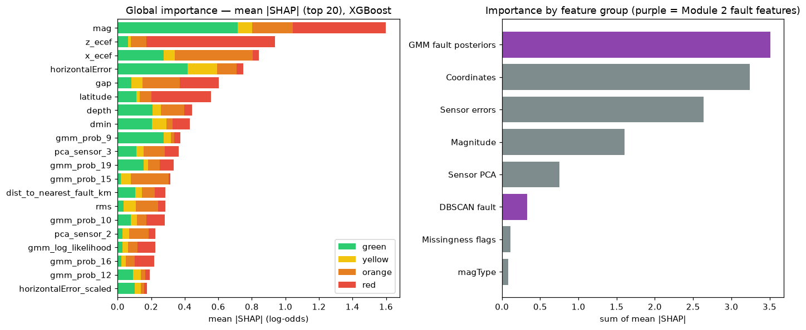
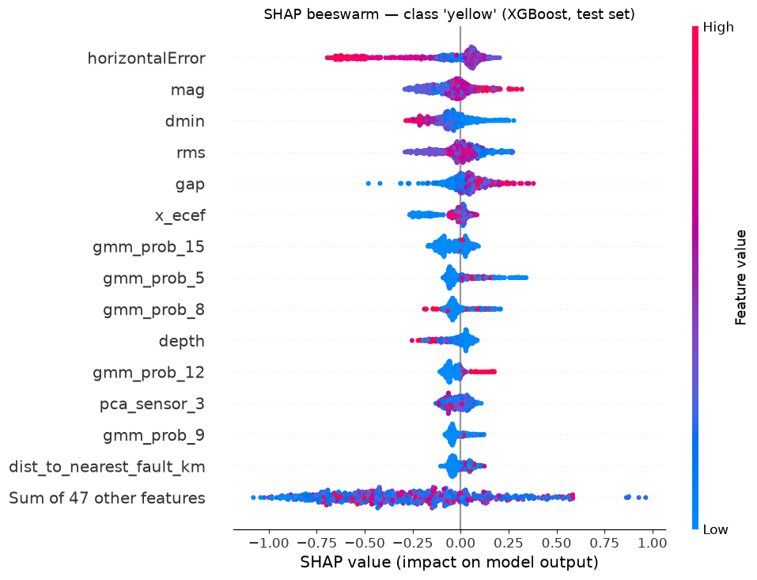
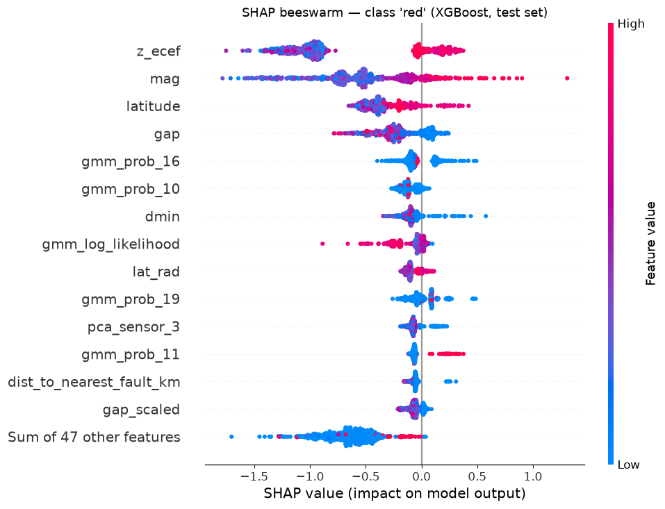

# Module 4 — SHAP Explainability Report

Model explained: **XGBoost (Augmented)** — the best gradient booster by 5-fold CV Macro F1
(0.4079). Explainer: `shap.TreeExplainer` (exact TreeSHAP), 666 test events,
values in log-odds space per class.

## Global importance
Top-5 features: `mag`, `z_ecef`, `x_ecef`, `horizontalError`, `gap`.

| feature | rank | yellow | orange | red | total |
|---|---|---|---|---|---|
| mag | 1 | 0.0863 | 0.2428 | 0.5548 | 1.5999 |
| z_ecef | 2 | 0.0162 | 0.0920 | 0.7685 | 0.9395 |
| x_ecef | 3 | 0.0647 | 0.4663 | 0.0363 | 0.8422 |
| horizontalError | 4 | 0.1762 | 0.1155 | 0.0374 | 0.7471 |
| gap | 5 | 0.0686 | 0.2204 | 0.2328 | 0.6020 |
| latitude | 6 | 0.0225 | 0.0695 | 0.3536 | 0.5558 |
| depth | 7 | 0.0488 | 0.1381 | 0.0482 | 0.4436 |
| dmin | 8 | 0.0846 | 0.0367 | 0.1052 | 0.4315 |
| gmm_prob_9 | 9 | 0.0419 | 0.0195 | 0.0391 | 0.3747 |
| pca_sensor_3 | 10 | 0.0428 | 0.1254 | 0.0850 | 0.3647 |
| gmm_prob_19 | 11 | 0.0273 | 0.0680 | 0.0853 | 0.3347 |
| gmm_prob_15 | 12 | 0.0598 | 0.2239 | 0.0105 | 0.3142 |
| dist_to_nearest_fault_km | 13 | 0.0403 | 0.0762 | 0.0619 | 0.2836 |
| rms | 14 | 0.0749 | 0.1326 | 0.0411 | 0.2831 |
| gmm_prob_10 | 15 | 0.0370 | 0.0551 | 0.1096 | 0.2804 |

Share of total mean |SHAP| contributed by the Module 2 fault features (DBSCAN + GMM): **31.3%**; by sensor PCA: **6.1%**.

## Fault-feature effects
| feature | rank (of 61) | mean |SHAP| total | Spearman(value, SHAP orange+red) |
|---|---|---|---|
| mag | 1 | 1.5999 | 0.6469 |
| depth | 7 | 0.4436 | -0.7650 |
| is_background_noise | 52 | 0.0056 | 0.5095 |
| dist_to_nearest_fault_km | 13 | 0.2836 | 0.6631 |
| gmm_log_likelihood | 17 | 0.2245 | -0.4364 |
| gmm_prob_9 | 9 | 0.3747 | -0.5570 |
| gmm_prob_19 | 11 | 0.3347 | 0.2121 |

- `mag` — rank 1; higher values push towards orange/red.
- `depth` — rank 7; higher values push away from orange/red.
- `is_background_noise` — rank 52; higher values push towards orange/red.
- `dist_to_nearest_fault_km` — rank 13; higher values push towards orange/red.
- `gmm_log_likelihood` — rank 17; higher values push away from orange/red.
- `gmm_prob_9` — rank 9; higher values push away from orange/red.
- `gmm_prob_19` — rank 11; higher values push towards orange/red.

## Beeswarm plots

## Reading the results
- Magnitude is expected to dominate: PAGER alerts are driven by shaking intensity, which scales with `mag`, then by depth
  (deep events shake the surface less) and by *where* the event is (exposed population, building vulnerability) — the
  coordinates and fault/mixture features are the model's only proxies for location.
- `gmm_prob_*` columns act as learned "seismic region" indicators: a high posterior for a component means the event sits
  in that 3D hypocentral cluster, and its SHAP sign tells whether that region tends to produce higher alerts.
- `dist_to_nearest_fault_km` measures how isolated an event is from the dense fault clusters found by DBSCAN; its
  dependence plot shows whether isolated (background) events are systematically lower- or higher-impact.
- SHAP shows association inside the model, not causation; with 5 red test events, red-class
  attributions rest on very few examples.
